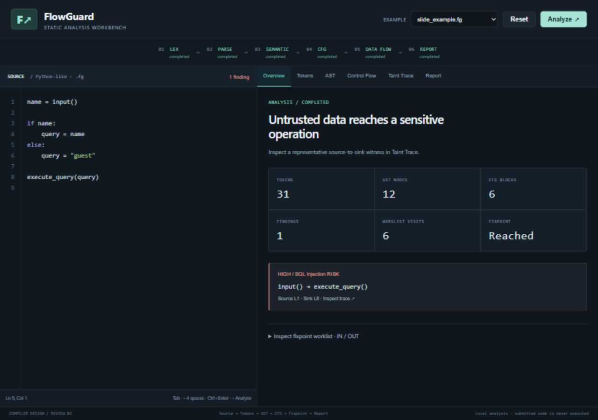

# FlowGuard

**A Mini Compiler-Based Security Analysis Tool**

A taint-tracking static analyzer using data-flow analysis, built for Compiler Design.

FlowGuard follows untrusted input through assignments, expressions, branches, loops,
and user-defined functions into modeled sensitive operations. It uses its own lexer,
recursive-descent parser, AST, control-flow graphs, and iterative worklist engine.
Submitted programs are analyzed as data and are never executed.

## Live application

**[Open FlowGuard on Vercel](https://flowguard-eight.vercel.app)**

Hosted in Shreyah101’s Vercel projects. The live site runs the real Python analyzer
through Vercel Functions; submitted code is never executed.

## Workbench preview



## Quick start on Windows

Clone Shreya's repository and enter the project folder:

```powershell
git clone https://github.com/shreyah101/flowguard.git
cd flowguard
```


Python 3.10 or newer. The application uses only the Python standard library.
From this folder in PowerShell:

```powershell
python flowguard_cli.py --serve
```

Open http://127.0.0.1:8080 in a browser. All fonts, scripts and graph rendering are
local; the demonstration does not require Internet access. Stop with Ctrl+C.
Use `--port 8081` if port 8080 is occupied.

Install the test dependency and run the suite:

```powershell
python -m pip install -r requirements-dev.txt
python -m pytest -q
```

Verified on 29 October 2026: **89 passed**. The original baseline had 9 tests.
`pytest.ini` restricts discovery to tests and disables its optional cache, avoiding
a Windows permissions problem observed with a temporary pytest cache directory.

## Compiler pipeline and architecture

```text
Source -> Lexer -> Tokens -> Parser -> AST -> Semantic checks
       -> Function CFGs -> Forward may-taint worklist -> Report
```

| File | Responsibility |
| --- | --- |
| `flowguard/lexer.py` | Tokens with line/column, indentation stack, lexical errors |
| `flowguard/parser.py`, `ast_nodes.py` | Custom recursive descent, precedence, located AST |
| `flowguard/semantic.py` | Definite assignment, function signatures, risk policies |
| `flowguard/cfg.py` | Basic blocks, labeled branches, joins, loops, return edges |
| `flowguard/taint_engine.py` | Finite source/category domain, worklist, call contexts, provenance |
| `flowguard/analyzer.py` | Stages, limits, failure states, shared response schema |
| `flowguard/report.py` | Terminal, JSON, Markdown reporting |
| `flowguard/server.py` | Local HTTP API and allowlisted web assets |
| `flowguard/web/` | Dependency-free source editor and six analysis views |
| `flowguard_cli.py`, `run_demo.py` | CLI and demonstration |

The course mapping remains: Module 1 lexical analysis; Module 2 syntax analysis;
Module 3 semantic analysis; Module 5 basic blocks, CFGs, data flow and fixpoints.

## Supported language

Identifiers, integers/floats, quoted strings, booleans, None, comments, assignments,
expression statements, calls, `if`/`elif`/`else`, `while`, top-level function
definitions, parameters, `return`, and `pass`. Arithmetic precedence is conventional:
`or`, `and`, `not`, comparisons, `+ -`, `* / %`, unary signs, calls/atoms.
Both indented and simple inline suites are supported. Tabs count as four spaces;
mixed spaces and tabs on an indented code line are rejected.

Strings support `\n`, `\t`, escaped quotes, and backslash. Unsupported escapes,
invalid characters, inconsistent dedents, and unterminated strings produce diagnostics.
Functions have local parameters/variables; global-variable reads from a function are
outside the supported scope and produce diagnostics. Top-level function signatures
are collected before use. Variables and parameters cannot shadow function names. Assignment in only one branch or only a loop body does
not definitely initialize a variable. Returning branches are excluded from the
continuing definite-assignment join. Types can be `Unknown`; obvious incompatible
literal operations produce warnings.

Unsupported syntax includes imports, attributes, containers, indexing, `for`,
`break`, classes, nested definitions, comprehensions, chained comparisons, keyword
arguments, and multiline parenthesized expressions. Use explicit `and` for multiple
comparisons. Unsupported programs fail rather than silently dropping constructs.

## Modeled security policy

Sources: `input`, `request_get`, `request_post`, `get_user_input`, `read_query_param`,
`get_env`, `read_cookie`, `read_user_input`, `get_request_param` (0 or 1 argument).

| Sinks | Risk category | Sensitive arguments | Teaching priority |
| --- | --- | --- | --- |
| `execute_query` | SQL Injection | 0 | HIGH |
| `system`, `popen`, `run_command` | Command Injection | 0 | CRITICAL |
| `eval`, `exec` | Code Injection | 0 | CRITICAL |
| `write_file` | Path Traversal / Arbitrary File Write | 0 and 1 | HIGH |
| `render_html` | Cross-Site Scripting (XSS) | 0 | MEDIUM |

All sinks take one argument except `write_file(path, content)`, which takes two.
The file-write policy deliberately treats both path and content as sensitive;
a finding on content alone is an educational unsafe-write concern, not evidence
that the path is attacker controlled. Sink names `eval` and `exec` are modeled
symbols only: FlowGuard never invokes them.

Sanitizers clear only the stated category:

- `sanitize`, `escape`, `escape_sql`, `sanitize_sql`: SQL only (legacy compatibility).
- `sanitize_command`: command only; `sanitize_path`: file-write only.
- `html_escape`: HTML only.
- `int`, `float`: all modeled string-injection categories under an assumed successful numeric conversion.
- `whitelist`: propagates taint; no allowlist is specified, so it clears nothing.

These are explicit teaching assumptions. Concatenating other tainted input can
reintroduce risk. They are not implementations of real sanitization functions or
guarantees about production code. `print`, `len`, `str`, `range` are recognized
builtins with conservative argument-to-result propagation. Unknown functions
produce semantic errors; they are never assumed to sanitize.

Priority rubric: CRITICAL denotes modeled dynamic code/shell operations, HIGH
query/file operations, MEDIUM HTML output. This is a classroom triage rubric, not
CVSS or an estimate of exploitability.

## Analysis algorithm and limits

Each variable maps to a set of `(source function, source line, risk category)`
facts. Joins union all predecessor facts. Assignment replaces the old value;
constants kill its taint. Expressions union operand facts. Sanitizers remove only
matching categories. The worklist starts at entry, schedules reachable successors
on first visit or changed output, and stops when no abstract output changes.
Sources in unreachable code after returns and literal-false branches do not emit
findings. Other branch predicates remain path insensitive; correlations are not solved.

Every nonrecursive call solves the function CFG using that call's argument states.
This supports branches, loops, internal sinks/sources, local reassignment, nested
calls and return propagation. Recursive/mutually recursive calls **fail explicitly**
with incomplete-analysis diagnostics. There is no recursive summary solver.

Provenance is maintained during transfer/join, with one representative witness per
source/category fact. It includes assignment/call/return/sink hops and a qualified
CFG walk. Loop hops are compacted; walks are capped at 256 entries. Witnesses are
possible abstract flows, not confirmed executions; branch correlation can cause
false positives. Witness metadata does not affect lattice equality or convergence.

Limits: 100,000 source characters, 10,000 tokens, 60 AST levels, 12 nested user
calls, 20,000 block visits across analysis contexts, 120,000 HTTP request bytes.
Exceeding a limit returns failure, never a clean security conclusion.

## Examples and expected results

| Example | Expected result |
| --- | --- |
| `slide_example.fg` | 1 SQL risk; source line 1, sink line 8; two-branch CFG |
| `command_injection.fg` | 1 command risk through concatenation |
| `sanitized_safe.fg` | 0 modeled unsafe flows (legacy SQL sanitizer) |
| `loop_accumulation.fg` | 1 file-write risk on content; loop reaches fixpoint |
| `interprocedural_call.fg` | 1 command risk through parameter and return |
| `constant_reassignment.fg` | 0 modeled unsafe flows; old value killed |
| `mismatched_sanitizer.fg` | 1 command risk despite SQL sanitization |
| `semantic_error.fg` | Failed: variable assigned on only one branch |
| `syntax_error.fg` | Failed: missing colon |

## CLI

```powershell
python flowguard_cli.py examples/slide_example.fg
python flowguard_cli.py examples/command_injection.fg --json
python flowguard_cli.py examples/slide_example.fg --tokens --ast --cfg --worklist
python flowguard_cli.py --all-examples
python run_demo.py
```

`--json` emits the full result; use alone for machine-readable output. A single-file
analysis exits 2 on diagnostics that prevent analysis, 0 on completed analysis
whether or not it has findings. Findings indicate potential risk. No findings do
not establish universal security. The demo runner is not a test runner.

## Workbench and API

Overview shows actual counters and the IN/OUT worklist. Tokens is a located table;
AST is expandable; Control Flow selects routine CFGs with zoom/fit; Taint Trace
selects findings and highlights source excerpts; Report exports JSON/Markdown.
Editing marks prior results stale and disables export until analysis is refreshed.
Delayed responses for older editor revisions are discarded.

- `GET /api/health`: server availability.
- `GET /api/examples` (`/api/presets` alias): filenames mapped to source strings.
- `POST /api/analyze`: `{"code": "name = input()\nexecute_query(name)"}`.

Valid request envelopes return `{"success": true, "data": {...}, "terminal_report": "..."}`.
Inside `data`, `status` is `completed` or `failed`; check it before interpreting
findings. `stages` exposes completed/failed/pending stages; `tokens`, `ast`, `cfgs`
(with blocks/nodes/edges), `diagnostics` (all stages), `semantic_diagnostics`, `findings`, `statistics`, and
`markdown_report` contain actual artifacts. Legacy `semantic_issues`,
`vulnerabilities`, `iteration_logs`, and Mermaid exports remain available.
Compiler failure returns partial artifacts and diagnostics. Invalid HTTP/JSON
requests return 400/413; unexpected internal failures return a generic 500 error.

## Review material

See `PROJECT_REPORT.md` for algorithms and complexity, `REVIEW2_DEMO.md` for the
5-7 minute script, and `REVIEW2_STATUS.md` for verified scope and remaining work.

## Project team

- Shreya Sundli — 24BCE2546 ([shreyah101](https://github.com/shreyah101))
- Pranakshay Agarwal — 24BCE2163
- Shlok Shembhole — 24BAI0205

Developed for the university Compiler Design project. The implementation and review
material describe an educational analysis model and its tested limitations.

## Deploy on Vercel

The repository includes `vercel.json` and four Python function entry points in
`api/`. The HTML/CSS/JavaScript in `flowguard/web` is served as static content;
`/api/analyze`, `/api/health`, `/api/examples` and `/api/presets` reuse the same
validated API handler and analyzer used locally. No submitted code is executed.
Python 3.12 is selected for Vercel; runtime requirements are dependency-free.

Import `shreyah101/flowguard` into the intended Vercel account, keep the repository
root directory, choose the Other framework preset and deploy with the committed
configuration. Alternatively, with Vercel CLI authenticated to the intended
account, run `vercel --prod`. Local Vercel project metadata is ignored by Git.
Production deployment verified at https://flowguard-eight.vercel.app under
Shreyah101’s projects. Live health, examples, UI assets, and analysis of the
slide/sanitizer/command/loop/function/syntax-error examples were checked successfully.
